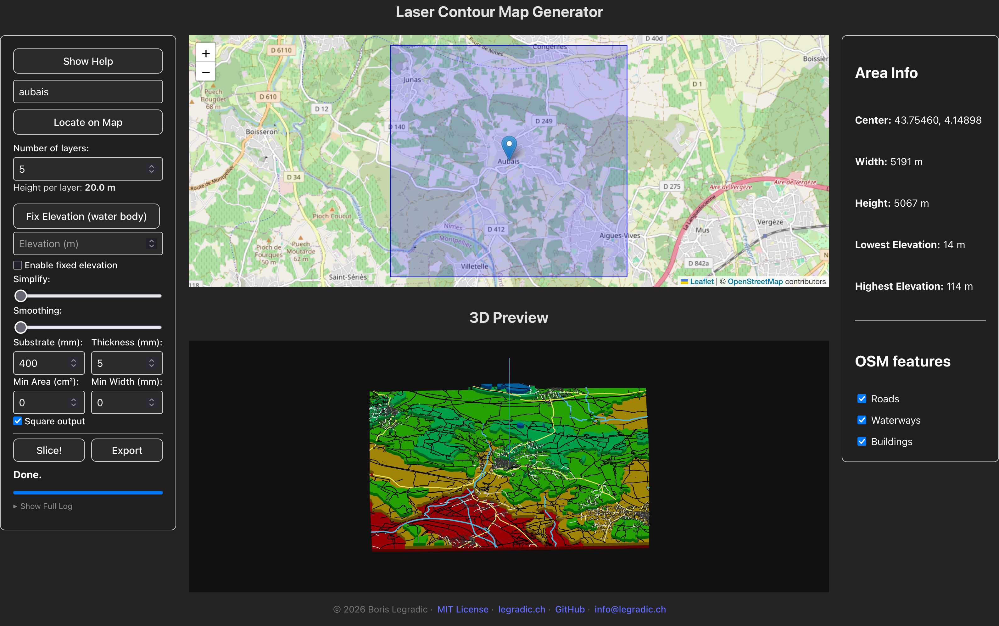

# Laser Slicer – Laser-Cuttable Contour Map Generator

Turn any region on Earth into a **stack of precisely-aligned SVG layers ready for laser cutting**.  
Laser Slicer downloads terrain elevation, ocean & Great Lakes bathymetry, and OpenStreetMap features (roads, buildings, waterways), slices contours at the interval you choose, and gives you:

Live site: [laserslicer.legradic.ch](https://laserslicer.legradic.ch)


* A **ZIP archive** of laser-ready SVG files (one per contour layer, with alignment markers and optional vector overlays)
* An interactive **Three.js 3D preview** of the stacked model (with dark/light mode and translucent water plane)
* **Multi-tier elevation & bathymetry**:
  * **SwissALTI3D (2 m)** for Switzerland
  * **SRTM (30 m)** global land elevation with outlier/noise filtering
  * **NOAA Great Lakes (~90 m)**, **EMODnet Europe (~115 m)**, and **NOAA ETOPO 2022 (~450 m)** underwater bathymetry
* **OSM Water Masking & Fixed Elevation** tools for crisp coastlines and flat inland lakes
* A **Dockerised Django + Celery + React workflow** with bounded LRU disk caches

---

## Features

| Front-end (React 19 + TypeScript + Vite) | Back-end (Django 5 + Celery + PostGIS/GDAL) |
|------------------------------------------|---------------------------------------------|
| **Leaflet map** – search any address or pan/zoom to select bounds | **Geocoding** & coordinate parsing via Nominatim |
| Automatic elevation range detection (`min` / `max` m) | **Multi-source DEM & Bathymetry** (SRTM 30m, SwissALTI3D 2m, EMODnet 115m, NOAA Great Lakes 90m & Global 450m) |
| Parameter panel – layer count/height, substrate size, smoothing, simplification | **OSM Water Masking** from tiles + shoreline blending & IGLD85 Great Lakes datum conversion |
| Waterbody click tool & optional fixed elevation (inland lakes) | Fetch & clip **OSM roads, buildings & waterways** per visible layer band |
| Toggle roads, buildings, waterways, bathymetry & water mask | Fast contour generation (`scikit-image` marching squares) & parallel `shapely` post-processing |
| Live **Three.js / R3F** 3D preview with water plane & dark/light themes | **Prepared-DEM `.npz` cache** & bounded **LRU disk cache eviction** (~3.5 GB cap) |
| **Download SVGs** – custom layer stroke colors packaged as a ZIP | Background task orchestration via **Celery + Redis** |

---

## High-Level Architecture

1. **Frontend (React 19 + Vite)**: User selects a bounding box and configures slicing parameters (layer height/count, substrate size, smoothing, bathymetry, and OSM overlays).
2. **API (Django REST Framework)**: Validates inputs and creates tracked background job records (`ElevationJob`, `ContourJob`, `SVGJob`).
3. **Task Queue (Celery + Redis)**: Offloads raster/vector processing to background workers.
4. **Slicing Pipeline (`ContourSlicingJob`)**:
   * **Concurrent Data Fetch**: Fetches SRTM 30m / SwissALTI3D 2m land tiles, NOAA / EMODnet bathymetry, OSM water-mask tiles, and Overpass vector features in parallel.
   * **DEM Fusion & Caching**: Applies OSM water masking, blends land and bathymetry (including Great Lakes IGLD85 surface datums), fills voids, and caches the prepared DEM array (`.npz`).
   * **Contour & Geometry Processing**: Generates closed contour bands via marching squares (`skimage.measure.find_contours`), then runs parallel UTM projection, scaling, simplification, and thin-feature filtering with `shapely`.
   * **Vector Clipping & Export**: Clips OSM roads, waterways, and buildings to each layer's visible area (`band[i] - band[i+1]`) and exports stacked SVG files into a downloadable ZIP archive.

---

## Quick Start (Docker)

```bash
# 1. Clone the repo
git clone https://github.com/borsic77/laser_slicer.git
cd laser_slicer

# 2. Configure environment
cp env.example .env

# 3. Build and start all services
docker compose up --build -d
```

Visit **http://localhost:5173** in your browser.  
The frontend communicates with the Django API at **http://localhost:8000**. Ensure your `.env` defines matching `DJANGO_CORS_ALLOWED_ORIGINS` and `DJANGO_CSRF_TRUSTED_ORIGINS` so the browser can send the `csrftoken` cookie with each request.

---

## Local Development (without Docker)

| Requirement | Version |
|-------------|---------|
| Python      | 3.10+ (managed via `uv`) |
| Node.js     | 18+     |
| PostgreSQL  | 16      |
| Redis       | 7       |
| GDAL        | 3.6+    |

```bash
# Backend setup & tests
uv sync
.venv/bin/pytest -q

# Frontend setup & tests
npm --prefix frontend ci
npm --prefix frontend test -- --run
```

See the **[Developer Startup Guide](dev_startup.md)** for full local startup instructions.

---

## Project Layout

```text
.
├── config/             # Django settings, URL routing, and Celery configuration
├── core/               # Backend application
│   ├── services/       # Domain services (contour slicing, elevation, bathymetry, OSM, SVG ZIP)
│   └── utils/          # Geospatial, raster, contour, tile, and bounded LRU cache helpers
├── frontend/           # React 19 + TypeScript + Vite SPA
├── tests/              # Backend pytest suite
├── data/               # Bounded runtime caches (srtm_cache, alti3d_cache, bathy_cache, osm_cache, processed_dem_cache)
├── docker-compose*.yml
└── README.md
```

---

## API Endpoints

| Method | Endpoint                          | Description                                          |
|--------|-----------------------------------|------------------------------------------------------|
| `POST` | `/api/elevation-range/`           | Start async min/max elevation calculation for bbox   |
| `GET`  | `/api/elevation-range/<uuid>/`    | Poll elevation range job status and result           |
| `POST` | `/api/slice/`                     | Start async contour slicing job                      |
| `GET`  | `/api/slice/<uuid>/`              | Poll slicing job progress and GeoJSON layer results  |
| `POST` | `/api/export-svgs/`               | Start async SVG ZIP generation job                   |
| `GET`  | `/api/export-svgs/<uuid>/`        | Poll SVG export job status and download URL          |
| `GET`  | `/api/waterbody/`                 | Fetch OSM waterbody polygon containing a `lat`/`lon` |
| `GET`  | `/api/elevation`                  | Sample single-point SRTM elevation at `lat`/`lon`    |
| `GET`  | `/api/geocode`                    | Geocode an address or coordinate string              |

---

## Cache Configuration

All disk caches under `data/` enforce automatic LRU eviction (down to 85% of the configured limit) on write and via the hourly `cleanup_old_media` task:

| Environment Variable         | Default (`MB`) | Purpose                                     |
|------------------------------|----------------|---------------------------------------------|
| `TILE_CACHE_MAX_MB`          | `1024`         | SRTM `.hgt.gz` elevation tiles              |
| `ALTI3D_CACHE_MAX_MB`        | `1024`         | SwissALTI3D 2m GeoTIFF tiles                |
| `BATHY_CACHE_MAX_MB`         | `512`          | NOAA / EMODnet cropped bathymetry GeoTIFFs  |
| `OSM_CACHE_MAX_MB`           | `512`          | Overpass JSON cache + OSM water-mask PNGs   |
| `PROCESSED_DEM_CACHE_MAX_MB` | `512`          | Prepared/merged DEM `.npz` arrays           |

---

## Contributing

1. Fork the project & create a feature branch (`git checkout -b feature/my_feature`)
2. Format and lint (`uvx ruff format . && uvx ruff check .` and `npm --prefix frontend run lint`)
3. Ensure backend and frontend tests pass (`.venv/bin/pytest -q` and `npm --prefix frontend test -- --run`)
4. Open a Pull Request

---

## License

Distributed under the **MIT License**.  
See [`LICENCE`](LICENCE) for more information.

---

## Author

Created by **Boris Legradic**  
Feel free to reach out via [GitHub](https://github.com/borsic77) or [email](mailto:boris@legradic.ch)

---

## Acknowledgements

* NASA / NGA – SRTM 30m elevation data
* swisstopo – SwissALTI3D 2m elevation data for Switzerland
* NOAA NCEI & EMODnet – Great Lakes, European, and global ETOPO 2022 bathymetry
* OpenStreetMap, Overpass API & Nominatim
